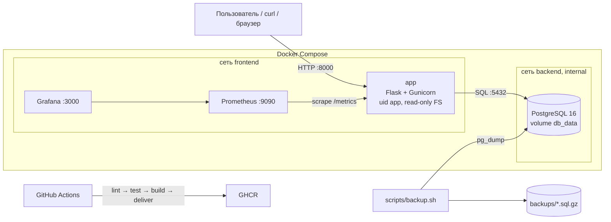

# Информационная система учёта успеваемости студентов

СРО №15 «Комплексное применение инструментов DevOps в информационных системах», вариант 2.
Дисциплина «Прикладные аспекты DevOps».

Система хранит сведения о студентах, дисциплинах и оценках, рассчитывает средний балл, буквенную
оценку и GPA (взвешенный по кредитам), формирует ведомость студента и рейтинг группы. Работает через
REST API в Docker-контейнерах, с CI/CD, мониторингом, резервным копированием и восстановлением БД.

## Архитектура



| Компонент | Технология | Назначение |
|---|---|---|
| app | Python 3.12, Flask, Gunicorn | REST API, бизнес-логика, логи в JSON, `/health`, `/metrics` |
| db | PostgreSQL 16 | Хранение студентов, дисциплин и оценок (том `db_data`) |
| prometheus, grafana | профиль `monitoring` | Сбор метрик, оповещения, дашборд |
| scripts/ | Bash | Запуск, остановка, мониторинг, бэкап, восстановление, проверка безопасности |
| .github/workflows | GitHub Actions | CI/CD-конвейер |

## Быстрый старт

```bash
git clone https://github.com/Zhanerkedas/grades-devops.git && cd grades-devops
cp .env.example .env          # задайте свои пароли
./scripts/start.sh            # или ./scripts/start.sh --monitoring
./scripts/seed.sh             # тестовые данные
curl http://localhost:8000/api/books
```

Grafana: http://localhost:3000 (дашборд «Grades IS»), Prometheus: http://localhost:9090.

## API

| Метод | URL | Описание |
|---|---|---|
| GET / POST | `/api/students?group=` | Список студентов / добавить `{full_name, email, group_name}` |
| GET / DELETE | `/api/students/<id>` | Получить или удалить студента (вместе с оценками) |
| GET | `/api/students/<id>/transcript` | Ведомость: оценки, средний балл, GPA, кредиты |
| GET / POST | `/api/disciplines` | Список дисциплин / добавить `{title, credits}` |
| GET | `/api/disciplines/<id>/report` | Статистика дисциплины: средний, мин., макс., несдавшие |
| POST | `/api/grades` | Выставить или исправить оценку `{student_id, discipline_id, score}` |
| GET | `/api/groups/<group>/ranking` | Рейтинг группы по GPA |
| GET | `/api/stats` | Общая статистика |
| GET | `/health`, `/metrics` | Состояние и метрики Prometheus |

Правила расчёта:
- балл — целое число 0–100, одна оценка на пару «студент — дисциплина» (повторная заменяет);
- буквенная шкала: 95+ A (4.0), 90 A- (3.67), 85 B+ (3.33), 80 B (3.0), 75 B- (2.67), 70 C+ (2.33),
  65 C (2.0), 60 C- (1.67), 55 D+ (1.33), 50 D (1.0), ниже 50 F (0);
- средний балл — среднее арифметическое, округление до 2 знаков;
- GPA = Σ(GPA дисциплины × кредиты) / Σ кредитов.

## Управление инфраструктурой

| Команда | Make | Что делает |
|---|---|---|
| `./scripts/start.sh [--monitoring]` | `make up` | Сборка, запуск, ожидание готовности |
| `./scripts/stop.sh [--purge]` | `make down` | Остановка (данные сохраняются) |
| `./scripts/status.sh` | `make status` | `docker compose ps`, health, `docker stats` |
| `./scripts/analyze_logs.sh [1h]` | `make analyze` | Анализ JSON-логов: уровни, статусы, ошибки, медленные запросы |
| `./scripts/backup.sh` | `make backup` | `pg_dump` → `backups/*.sql.gz`, SHA-256, ротация |
| `./scripts/restore.sh [файл] [--production]` | `make restore` | Восстановление в тестовую БД и сверка данных |
| `./scripts/simulate_failure.sh` | `make failure` | Имитация отказа БД и проверка восстановления |
| `./scripts/smoke_test.sh` | `make smoke` | Проверка работающей системы |
| `./scripts/security_check.sh` | `make security` | Проверка секретов, пользователя, прав, портов |

## Тестирование

```bash
pip install -r requirements-dev.txt
python -m pytest -v --cov=app       # SQLite
TEST_DATABASE_URL=postgresql://... python -m pytest   # PostgreSQL
```

44 автотеста: расчёт среднего балла, GPA и буквенной шкалы на всех границах, API студентов, дисциплин и оценок,
ведомость, рейтинг, `/health` при отказе БД и формат метрик.

## CI/CD

Файл `.github/workflows/ci-cd.yml` запускается при push в `main` или `develop`, а также при pull request:

1. **lint**: flake8.
2. **test**: pytest на PostgreSQL (service container) и на SQLite, отчёт о покрытии.
3. **build**: `docker compose up`, smoke-тест, бэкап и восстановление, имитация отказа, проверка безопасности, Trivy.
4. **deliver** (только `main`): публикация образа в GitHub Container Registry.

## Безопасность

- Секреты лежат только в `.env`, а `.env` указан в `.gitignore`. В репозитории есть только `.env.example`.
- Контейнер работает от непривилегированного пользователя `app`, с read-only файловой системой.
  Включены `cap_drop: ALL` и `no-new-privileges`, заданы лимиты CPU и памяти.
- БД находится во внутренней сети `backend`, и её порт наружу не публикуется.
- Логи ротируются: максимум 3 файла по 10 МБ. У резервных копий права 600.
- В системе используются только вымышленные тестовые данные.
